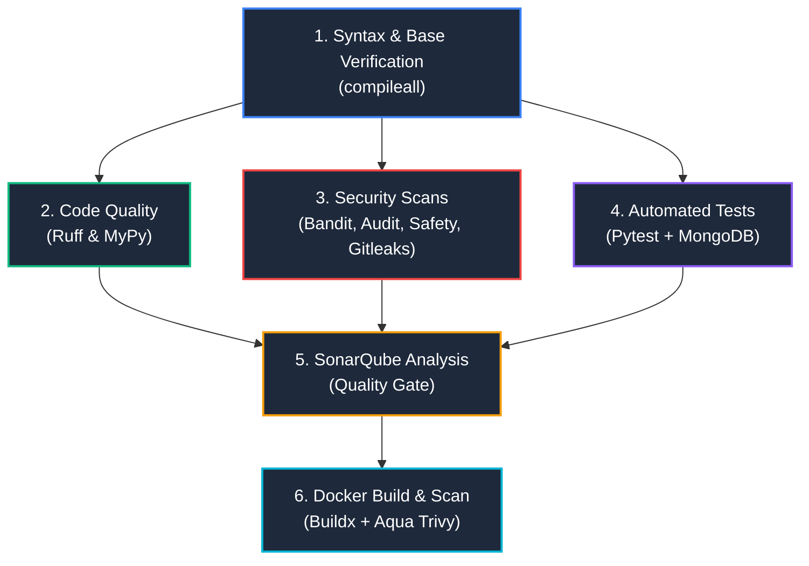

# Central Attendance Management System (CAMS)
## CI/CD Pipeline Documentation

This document provides a comprehensive architectural and operational overview of the automated continuous integration and security scanning pipeline configured for the Central Attendance Management System.

---

## 1. Pipeline Architecture & Tree Graph (DAG)

The CI/CD workflow is designed as a **Directed Acyclic Graph (DAG)** with 6 distinct stages. Rather than running sequentially in a single slow pipeline, jobs are organized into parallel branches that maximize execution speed and provide immediate visual feedback in the GitHub Actions dashboard.



### Triggers
* **Push**: Any commit pushed to the `main` branch.
* **Pull Request**: Any pull request targeted at the `main` branch.

---

## 2. Comprehensive Stage-by-Stage Breakdown

### Stage 1: Syntax & Base Verification (`syntax-and-setup`)
* **Role**: Root gatekeeper for the entire pipeline.
* **Runner**: `ubuntu-latest`
* **Python Runtime**: `3.12`
* **What it does**:
  1. Checks out the repository using `actions/checkout@v4`.
  2. Sets up Python 3.12 with pip package caching.
  3. Executes `python -m compileall app/ tests/ scripts/` to compile all Python source files into bytecode.
* **Why it matters**: Fast-fails the pipeline in seconds if any syntax errors, unclosed brackets, or invalid indentation exist before spending time starting database containers or downloading heavy dependencies.

---

### Stage 2: Code Quality & Type Checking (`code-quality`)
* **Dependencies**: Runs immediately after Stage 1 passes (`needs: [syntax-and-setup]`).
* **Tools**:
  * **Ruff (`v0.8.4`)**: High-performance Python linter that enforces PEP 8 styling, import sorting (`isort`), and Pyflakes/Flake8 bug detection rules.
  * **MyPy (`v1.13.0`)**: Static type analyzer checking type annotations across FastAPI request schemas, models, and service classes.
* **Key Commands**:
  ```bash
  ruff check app/ tests/ scripts/
  mypy --explicit-package-bases --ignore-missing-imports app/
  ```
* **Why it matters**: Maintains high code maintainability, prevents common typing bugs, and ensures all developers follow consistent style standards.

---

### Stage 3: Security Scans (`security-scans`)
* **Dependencies**: Runs in parallel with Stages 2 and 4 (`needs: [syntax-and-setup]`).
* **Tools**:
  * **Bandit (`v1.8.0`)**: Static Application Security Testing (SAST) tool analyzing the Python Abstract Syntax Tree (AST) for common security vulnerabilities (e.g., hardcoded passwords, weak hash algorithms, SQL/NoSQL injection patterns). Excludes rule `B104` (binding to `0.0.0.0`) which is required for Docker containers.
  * **pip-audit (`v2.7.3`)**: Audits Python dependencies against the Python Packaging Advisory Database (PyPA) for known Common Vulnerabilities and Exposures (CVEs).
  * **Safety**: Scans `requirements.txt` against vulnerability databases to alert on vulnerable third-party packages.
  * **Gitleaks (`v2`)**: Scans git commit history to prevent accidental leakage of hardcoded API keys, JWT secrets, passwords, or cloud credentials.
* **Key Commands**:
  ```bash
  bandit -r app/ -ll -s B104
  pip-audit -r requirements.txt
  safety check -r requirements.txt
  ```
* **Why it matters**: Provides DevSecOps assurance by catching vulnerabilities early in the development lifecycle before code reaches staging or production.

---

### Stage 4: Automated Unit & API Tests (`test-suite`)
* **Dependencies**: Runs in parallel with Stages 2 and 3 (`needs: [syntax-and-setup]`).
* **Service Container**:
  * **MongoDB 7.0**: Spun up as an isolated Docker service container (`mongo:7.0`) with automated health checks using `mongosh ping`.
* **Tools**:
  * **Pytest (`v8.3.4`)**: Test runner executing the automated test suite.
  * **pytest-asyncio**: Handles asynchronous test cases against FastAPI endpoints.
  * **pytest-cov**: Measures test code coverage and outputs a standard `coverage.xml` report.
* **Test Suites Executed**:
  1. **Unit Tests (`tests/unit`)**: Fast tests validating business logic, attendance calculation algorithms, and authentication token generation without network overhead.
  2. **API Tests (`tests/api`)**: Integration tests sending live HTTP requests via `httpx.AsyncClient` against the FastAPI endpoints (`/auth`, `/attendance`, `/employees`, `/leave`, `/reports`, `/admin`).
* **Artifact Upload**:
  * Uploads test results (`reports/`) and `coverage.xml` as GitHub Actions build artifacts (persisted for 14 days) via `actions/upload-artifact@v4`.

---

### Stage 5: SonarQube Analysis (`sonarqube`)
* **Dependencies**: Merge node waiting for all code quality, security, and test jobs to complete (`needs: [code-quality, security-scans, test-suite]`).
* **Configuration File**: [`sonar-project.properties`](file:///c:/Users/vishr/OneDrive/Documents/vishu%20backend/central-attendance-system/sonar-project.properties)
* **What it does**:
  1. Downloads the `coverage.xml` report produced by Stage 4.
  2. Evaluates if the `SONAR_TOKEN` secret is configured in repository secrets.
  3. If configured, runs `SonarSource/sonarqube-scan-action` to report code smells, duplicate code, test coverage percentages, and security hot-spots to your SonarQube / SonarCloud dashboard.
  4. If not configured, gracefully logs an informational skip message so the pipeline continues without failing.

---

### Stage 6: Docker Build & Vulnerability Scan (`docker-build-and-scan`)
* **Dependencies**: Final stage running after code is verified and tested (`needs: [sonarqube]`).
* **Tools**:
  * **Docker Buildx**: Builds the container image according to the project's [`Dockerfile`](file:///c:/Users/vishr/OneDrive/Documents/vishu%20backend/central-attendance-system/Dockerfile):
    ```bash
    docker build -t central-attendance-system:${{ github.sha }} .
    ```
  * **Aqua Security Trivy (`aquasecurity/trivy-action`)**: Comprehensive vulnerability scanner that inspects:
    * Operating system packages inside the Debian base image (`python:3.12-slim`).
    * Python packages installed in `/app`.
    * Flags any `CRITICAL` or `HIGH` vulnerabilities in a readable table format in the CI log.
* **Why it matters**: Guarantees that the packaged container image ready for deployment does not ship with known OS-level or container-level security holes.

---

## 3. Pipeline Configuration Matrix

| Stage | Job Name | Primary Tool | Primary Objective |
| :--- | :--- | :--- | :--- |
| **1** | `syntax-and-setup` | Python compileall | Fast-fail on syntax mistakes |
| **2** | `code-quality` | Ruff, MyPy | Clean style and static type safety |
| **3** | `security-scans` | Bandit, pip-audit, Safety, Gitleaks | SAST, dependency CVEs, secret leak protection |
| **4** | `test-suite` | Pytest, pytest-cov, MongoDB 7.0 | Automated unit & API functional testing |
| **5** | `sonarqube` | SonarScanner | Code health metrics & Quality Gate |
| **6** | `docker-build-and-scan`| Docker Buildx, Aqua Trivy | Container image build & image vulnerability scan |

---

## 4. Local Pre-Commit Verification (Quick Guide)

To verify all checks locally before pushing to GitHub, you can run:

```powershell
# 1. Syntax check
python -m compileall app/ tests/ scripts/

# 2. Linting
ruff check app/ tests/ scripts/

# 3. Security scan
bandit -r app/ -ll -s B104

# 4. Run tests
pytest tests/unit tests/api -v
```
