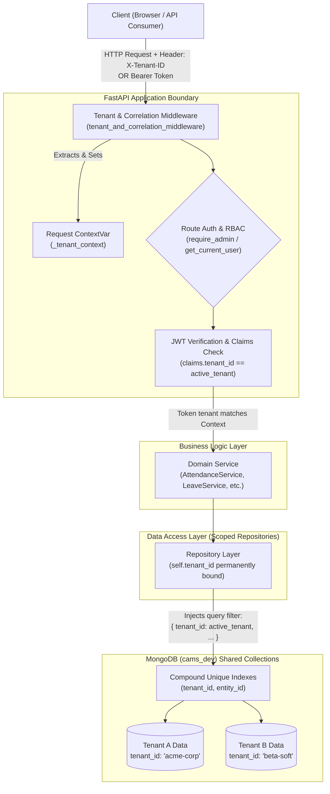
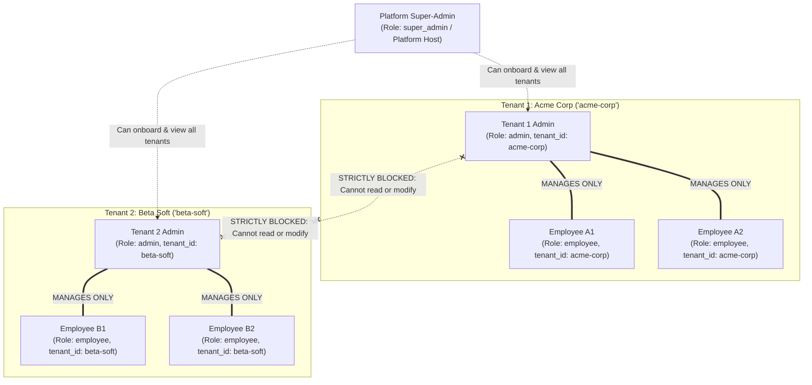

# Multi-Tenancy Architecture & Security Specification

> **System**: Central Attendance Management System (CAMS)  
> **Model**: Shared Database with Discriminator (`tenant_id`) & Composite Index Isolation  
> **Version**: 1.2.0  
> **Security Clearance**: Enterprise Multi-Tenant SaaS Standard  

---

## 1. Executive Summary: Why Multi-Tenancy & Why This Model?

### What is Multi-Tenancy?
Multi-tenancy is an architectural model in which a single software application and its underlying infrastructure serve multiple client organizations (**tenants**). Each tenant's data is isolated and invisible to all other tenants, while sharing common application compute, updates, and maintenance.

### Architectural Models Compared

| Evaluation Criteria | 1. Database-per-Tenant | 2. Schema-per-Tenant | **3. Shared Database (CAMS Chosen Model)** |
| :--- | :--- | :--- | :--- |
| **Data Separation** | Separate DB instances or DB names per client. | Separate namespaces within single DB. | **Discriminator key (`tenant_id`) across shared collections.** |
| **Operational Overhead** | Extremely High: Migrating 100 tenants requires running 100 database migrations. | High: DB connection management and namespace overhead. | **Minimal: Single schema migration applies globally to all tenants in one go.** |
| **Resource & Cost Efficiency**| Wasteful: Idle tenants consume RAM and fixed connection pools. | Moderate. | **Optimal: High-density hosting; compute and RAM dynamically shared.** |
| **Connection Pooling** | Complex: Hundreds of MongoDB connection pools can exhaust sockets. | Moderate connection reuse. | **Maximum Performance: Single high-speed connection pool with PyMongo Async.** |
| **Tenant Onboarding Speed** | Slow (seconds to minutes): Requires provisioning new DB and indexes. | Moderate. | **Instant (sub-millisecond): One atomic insert into `tenants` collection.** |
| **Cross-Tenant Auditing & Background Jobs** | Complex: Workers must maintain dynamic DB connections for every tenant. | Complex loop. | **Simple & Deterministic: Background worker iterates active tenants in single pass.** |

---

## 2. System Architecture & Request Lifecycle

Below is the end-to-end architecture diagram showing how a request moves from the Client to the Database with tenant isolation enforced at every layer.



---

## 3. How the Shared Database Model Works

In CAMS, all organizations share the same database (`cams_dev`), but every single operational document has a mandatory discriminator field: `tenant_id`.

### Example: Coexistence of Identical Employee IDs across Tenants

In a single-tenant system, `employee_id` must be globally unique across the entire database. If Organization A has `EMP-001`, Organization B cannot use `EMP-001`.

In CAMS multi-tenancy, **Organization A and Organization B can both have `EMP-001`**, because uniqueness is scoped compoundly to `(tenant_id, employee_id)`:

#### Collection: `employees`
```json
// Document 1: Belongs to Acme Corp
{
  "_id": ObjectId("65f1a1001111111111111111"),
  "tenant_id": "acme-corp",
  "employee_id": "EMP-001",
  "name": "Alice Johnson",
  "email": "alice@acme.com",
  "department": "Engineering"
}

// Document 2: Belongs to Beta Soft (Same Employee ID, Zero Conflict)
{
  "_id": ObjectId("65f1a2002222222222222222"),
  "tenant_id": "beta-soft",
  "employee_id": "EMP-001",
  "name": "Bob Smith",
  "email": "bob@betasoft.com",
  "department": "Sales"
}
```

### Compound Unique Indexes: Mathematical Guarantee of Isolation

The database itself prevents collision or leakage using compound unique indexes defined in `app/database/indexes.py`:

```python
# Compound Unique Index: uniqueness is evaluated on BOTH fields together
await db.employees.create_index(
    [("tenant_id", 1), ("employee_id", 1)],
    unique=True,
    name="idx_employees_tenant_emp_id",
)

await db.employees.create_index(
    [("tenant_id", 1), ("email", 1)],
    unique=True,
    name="idx_employees_tenant_email",
)
```

| Collection | Compound Unique Index | Benefit |
| :--- | :--- | :--- |
| `employees` | `(tenant_id, employee_id)` & `(tenant_id, email)` | Same employee ID or email can exist across different organizations. |
| `admin_users` | `(tenant_id, username)` | Admin usernames are scoped per tenant (e.g. `admin` in Acme vs `admin` in Beta). |
| `attendance` | `(tenant_id, employee_id, date)` | Daily attendance records are strictly isolated. |
| `leave_balances` | `(tenant_id, employee_id, year, leave_type)` | Quota allocation is isolated per employee per tenant. |
| `holidays` | `(tenant_id, date)` | Each organization maintains independent company holiday calendars. |
| `notification_logs`| `(tenant_id, dedup_key)` | Email deduplication guarantees alert notices never bleed across tenants. |

---

## 4. Roles & Access Control Matrix

CAMS enforces a strict Role-Based Access Control (RBAC) hierarchy across tenants:



### Detailed Role Permissions Matrix

| Feature / Action | Platform Super-Admin | Tenant 1 Admin (`acme-corp`) | Tenant 2 Admin (`beta-soft`) | Tenant 1 Employee | Tenant 2 Employee |
| :--- | :---: | :---: | :---: | :---: | :---: |
| **Onboard New Tenant Organization** | ✅ Yes | ❌ Blocked | ❌ Blocked | ❌ Blocked | ❌ Blocked |
| **View Tenant List (`GET /tenants`)** | ✅ All Tenants | ❌ Restricted | ❌ Restricted | ❌ Blocked | ❌ Blocked |
| **Manage Acme Employees** | ✅ Full Access | ✅ Full Access | ❌ **404 / 403 Forbidden** | ❌ Blocked | ❌ Blocked |
| **Manage Beta Employees** | ✅ Full Access | ❌ **404 / 403 Forbidden** | ✅ Full Access | ❌ Blocked | ❌ Blocked |
| **Approve Acme Leave & Regularization**| ✅ | ✅ Full Access | ❌ **Blocked** | ❌ Blocked | ❌ Blocked |
| **Clock-In / Clock-Out (Punch)** | ❌ (Service role) | ❌ | ❌ | ✅ Own punches only | ✅ Own punches only |
| **View Audit Trail** | ✅ All audit logs | ✅ Acme audit logs only | ✅ Beta audit logs only | ❌ Blocked | ❌ Blocked |

---

## 5. Defense-in-Depth: How Security Is Enforced

Security is not dependent on a single firewall or if-statement. CAMS uses **5 layers of defense** to ensure data can never leak between tenants:

```
┌─────────────────────────────────────────────────────────────┐
│ Layer 1: ContextVar & Middleware Resolution                 │
├─────────────────────────────────────────────────────────────┤
│ Layer 2: Cryptographic JWT Claims Validation                │
├─────────────────────────────────────────────────────────────┤
│ Layer 3: Scoped Repository Injection (Automatic Filtering)  │
├─────────────────────────────────────────────────────────────┤
│ Layer 4: MongoDB Compound Unique Indexing                   │
├─────────────────────────────────────────────────────────────┤
│ Layer 5: Cross-Tenant Scheduled Worker Isolation            │
└─────────────────────────────────────────────────────────────┘
```

### Layer 1: Request-Scoped `ContextVar`
In Python async servers, global variables cause race conditions. CAMS uses `ContextVar` (`app/core/tenant.py`), which is bound to the individual async request task:
```python
_tenant_context: ContextVar[str] = ContextVar("current_tenant_id", default="default")

def get_current_tenant_id() -> str:
    return _tenant_context.get()
```
When a request completes, the context is automatically reset, preventing context contamination across requests.

### Layer 2: Cryptographic JWT Claims Verification
When an admin or employee logs in, their `tenant_id` is cryptographically signed inside the JWT payload:
```json
{
  "sub": "ADM-01",
  "username": "acme_admin",
  "role": "admin",
  "tenant_id": "acme-corp",
  "exp": 1729180000
}
```
If an attacker manually changes their HTTP header to `X-Tenant-ID: beta-soft`, the authentication dependency verifies the token's embedded `tenant_id`. If there is a mismatch, the request is rejected with `403 Forbidden`.

### Layer 3: Automatic Scoped Repository Queries
Every database query in a repository prepends `{"tenant_id": self.tenant_id}`:
```python
class EmployeeRepository:
    def __init__(self, db: Any, tenant_id: str = "default") -> None:
        self.col = db.employees
        self.tenant_id = tenant_id

    async def find_by_id(self, employee_id: str) -> dict[str, Any] | None:
        # It is physically impossible to fetch an employee from another tenant:
        return await self.col.find_one(
            {"tenant_id": self.tenant_id, "employee_id": employee_id},
            {"_id": 0}
        )
```
Even if an admin knew the exact database ObjectId of another organization's employee, the query returns `None` (404 Not Found) because the tenant filter does not match.

### Layer 4: Background Worker Isolation
The background policy evaluation engine (`app/workers/monitoring.py`) monitors all tenants deterministically without cross-tenant mixing:
```python
async def run_all_tenants_monitoring_cycle(db: Any):
    tenants = await db.tenants.find({"status": "active"}).to_list(100)
    for tenant in tenants:
        t_id = tenant["tenant_id"]
        # Evaluates compliance using that specific tenant's custom thresholds:
        custom_thresholds = PolicyThresholds(**tenant.get("settings", {}))
        await run_monitoring_cycle(db, tenant_id=t_id, custom_thresholds=custom_thresholds)
```
Each iteration operates on a fresh, isolated set of repositories strictly scoped to `t_id`.

---

## 6. Real-World Attack Scenarios & Mitigations

### Attack 1: Insecure Direct Object Reference (IDOR)
* **Attack**: Tenant 1 Admin tries to query `GET /api/v1/attendance/EMP-999` where `EMP-999` belongs to Tenant 2.
* **Defense**: The repository runs `find_sessions(tenant_id="tenant-1", employee_id="EMP-999")`. The query returns `[]`. The system returns `404 Employee Not Found`. Tenant 1 has no way of knowing `EMP-999` exists in Tenant 2.

### Attack 2: Header Tampering (`X-Tenant-ID`)
* **Attack**: A logged-in Tenant 1 user sends `X-Tenant-ID: competitor-corp` in their request headers.
* **Defense**: When authenticating with their Bearer token, the system validates that the user's signed JWT claim `tenant_id == "tenant-1"`. The user cannot access `competitor-corp` data without having valid cryptographic credentials for `competitor-corp`.

### Attack 3: Data Collision (Duplicate Usernames / IDs)
* **Attack**: Organization B tries to register an admin with username `admin`, which Organization A already uses.
* **Defense**: Handled seamlessly. The index `idx_admin_tenant_username` enforces uniqueness on `(tenant_id, username)`. `("acme-corp", "admin")` and `("beta-soft", "admin")` both exist without conflict.

---

## 7. Summary of Key Files Implementing Multi-Tenancy

| Component | File Path | Responsibility |
| :--- | :--- | :--- |
| **Tenant Context** | `app/core/tenant.py` | Thread-safe & async-safe `ContextVar` management. |
| **Middleware** | `app/main.py` | Extracts tenant from `X-Tenant-ID` header or JWT. |
| **Indexes** | `app/database/indexes.py` | Configures compound unique indexes across collections. |
| **Tenant Repository** | `app/repositories/tenant_repo.py` | CRUD operations for tenant organizations. |
| **Tenant API Router** | `app/api/v1/tenants.py` | Endpoints to onboard and manage tenant organizations. |
| **Auth JWT Token** | `app/security/auth.py` | Embeds and validates `tenant_id` claim in JWTs. |
| **Repositories** | `app/repositories/*_repo.py` | All queries automatically injected with `tenant_id`. |
| **Worker Scheduler** | `app/workers/monitoring.py` | Iterates active tenants applying custom policy rules. |
| **Frontend API Client** | `static/js/api.js` | Automatically sets `X-Tenant-ID` header on all requests. |
| **Frontend UI** | `static/index.html` & `app.js` | Multi-tenant organization manager and onboarding modal. |
