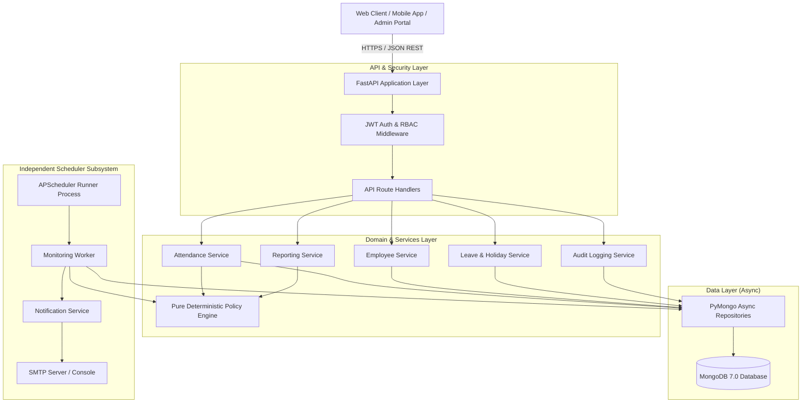
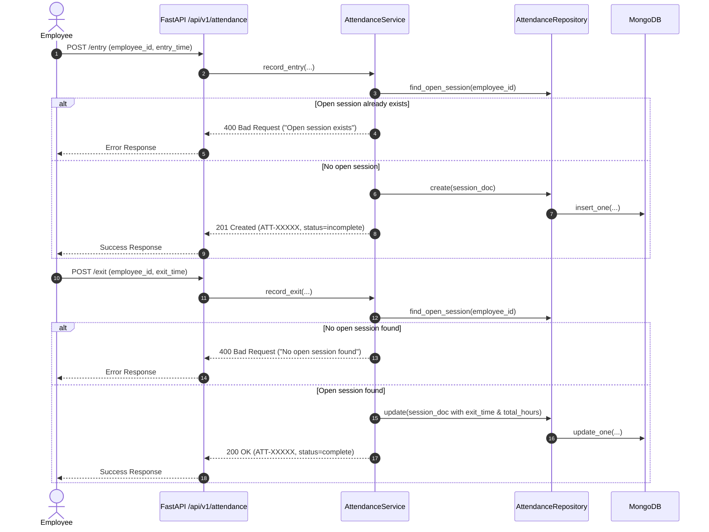
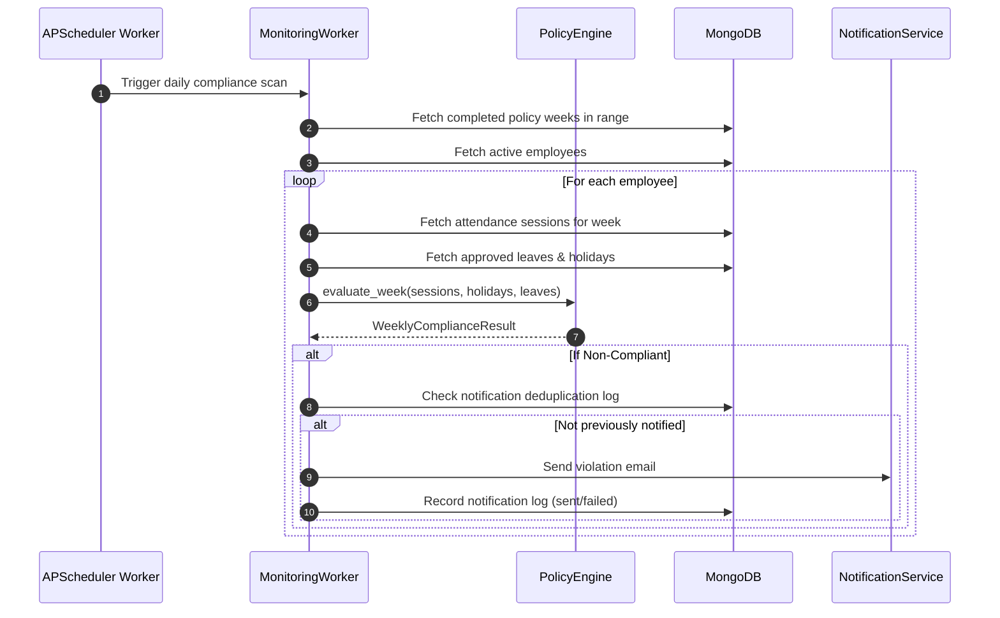

# Central Attendance Management System (CAMS) - Project Overview & Technical Specification

## 1. Executive Summary

The **Central Attendance Management System (CAMS)** is an enterprise-grade backend service designed to track, evaluate, and audit employee attendance with mathematical precision. 

In many corporate organizations, hybrid work arrangements, split work shifts, flexible schedules, and complex leave/holiday calendars make manual or naive attendance calculations prone to errors, unfair penalties, and compliance gaps. CAMS was designed to eliminate these issues by providing:

1. **Deterministic Attendance Evaluation**: Pure mathematical rules determine employee compliance—eliminating arbitrary calculations or LLM hallucinations.
2. **True Multi-Session Support**: Supports split shifts on the same day without double-counting hours, using timeline interval-merging algorithms.
3. **Dynamic Calendar Adaptability**: Automatically scales down attendance obligations during weeks containing public holidays or approved personal leaves.
4. **Autonomous Compliance Monitoring**: A detached background worker evaluates completed policy weeks and sends email notifications with retry logic and deduplication.
5. **High Security & Compliance**: Strict role-based access control (RBAC), Argon2 password hashing, HS256 JWT tokens, and spreadsheet formula injection defense on exported CSVs.

---

## 2. High-Level Architecture

CAMS employs a layered architecture separating API ingestion from heavy business calculation and background task execution:



---

## 3. Core Architectural Decisions

### 3.1 Direct PyMongo Async Driver (No Motor, No ORM)
Instead of Motor (an older async wrapper) or heavy SQL-centric ORMs like SQLAlchemy, CAMS directly leverages **PyMongo 4.10+ native `AsyncMongoClient`**. This provides:
- Maximum asynchronous I/O performance.
- True non-blocking execution inside FastAPI coroutines.
- Explicit, transparent MongoDB queries without ORM abstraction overhead.

### 3.2 Stateless, Deterministic Policy Engine
The policy calculation engine in `app/services/policy_service.py` is **100% pure and stateless**:
- It takes raw attendance records, holiday sets, leave sets, and policy threshold configurations as input.
- It performs mathematical interval merging and proportional ratios.
- It returns an immutable `WeeklyComplianceResult`.
- It has **zero database or network dependencies**, making it lightning fast and easily unit-testable.

### 3.3 Scheduler Isolation
APScheduler is **not run inside the FastAPI Uvicorn web process**. Running schedulers inside web workers causes duplicate triggers when scaling horizontally. CAMS decouples the scheduler into a separate standalone process (`python -m app.workers.scheduler`) and independent Docker container.

### 3.4 UTC Timestamps with Localized Display
All records store `datetime` fields in standard UTC. Date conversion and day boundary demarcations are calculated relative to the company's designated operational timezone (`Asia/Kolkata` by default).

---

## 4. Business Logic & Compliance Rules

### 4.1 Policy Thresholds
The default weekly policy configuration:
- **Minimum Qualifying Days**: `3` days per week.
- **Minimum Total Hours**: `15.0` hours per week.
- **Minimum Average Hours per Day**: `5.0` hours per attended day.
- **Standard Working Days**: `5` days per week (Monday to Friday).
- **Week Boundaries**: Monday 00:00:00 to Monday 00:00:00 exclusive.

### 4.2 Multi-Session Timeline Merging
When an employee clocks in and out multiple times in a single day (e.g., morning shift, lunch break, afternoon shift), CAMS uses **Interval Merging** to calculate exact office presence:

```
Session 1: [09:00 ─── 13:00] (4 hours)
Session 2: [12:30 ─────── 17:00] (4.5 hours, overlapping by 30 mins)
Merged:    [09:00 ─────────────── 17:00] = 8.0 distinct hours credited
```
- Incomplete sessions (clocked in without clocking out) contribute `0.0` hours and are flagged as `incomplete`.
- Malformed sessions (`exit <= entry`) contribute `0.0` hours and are flagged as `invalid`.

### 4.3 Proportional Leave & Holiday Adjustment
When a company holiday or approved leave falls on a scheduled working day, the expected attendance requirements are scaled down proportionally:

$$\text{Eligible Days} = \text{Working Days} - (\text{Holidays} + \text{Approved Leaves})$$

$$\text{Adjusted Min Days} = \min\left(\text{Eligible Days}, \left\lceil \text{Min Days} \times \frac{\text{Eligible Days}}{\text{Working Days}} \right\rceil\right)$$

$$\text{Adjusted Min Hours} = \text{Min Hours} \times \frac{\text{Eligible Days}}{\text{Working Days}}$$

*Example*: If an employee takes 2 days of approved leave in a 5-day work week (leaving 3 eligible days):
- Expected days: $\lceil 3 \times \frac{3}{5} \rceil = \lceil 1.8 \rceil = 2\text{ days}$.
- Expected hours: $15.0 \times \frac{3}{5} = 9.0\text{ hours}$.

---

## 5. MongoDB Data Model & Indexes

| Collection | Description | Critical Indexes |
| :--- | :--- | :--- |
| `employees` | Master employee repository | `employee_id` (Unique), `email` (Unique), `department`, `is_active` |
| `attendance` | Individual clock-in / clock-out sessions | `attendance_id` (Unique), `(employee_id, date)`, `(employee_id, date, entry_time)`, `attendance_status` |
| `leave_requests`| Leave applications & approvals | `leave_id` (Unique), `(employee_id, start_date, end_date)`, `status` |
| `holidays` | Official organization holidays | `holiday_id` (Unique), `date` (Unique) |
| `notification_logs`| Delivery state and deduplication | `notification_id` (Unique), `(employee_id, week_start, notification_type)` |
| `audit_logs` | Immutable system event ledger | `(timestamp, actor_id)`, `(resource_type, resource_id)` |
| `admin_users` | System administrators and managers | `admin_id` (Unique), `username` (Unique), `email` (Unique) |

---

## 6. Project Layout

```
central-attendance-system/
├── app/
│   ├── api/
│   │   ├── dependencies.py          # FastAPI DI: DB injection, repos, auth, RBAC
│   │   └── v1/
│   │       ├── admin.py             # Audit log queries & manual worker triggers
│   │       ├── attendance.py        # Entry, exit, date query, history, corrections
│   │       ├── auth.py              # Login, JWT issuance, /me profile
│   │       ├── employees.py         # Employee CRUD, filtering, soft deletion
│   │       ├── health.py            # /live and /ready health probes
│   │       ├── leave.py             # Leave requests, approvals, holidays
│   │       ├── reports.py           # Unified reporting & formula-safe CSV export
│   │       └── router.py            # Master API router
│   ├── database/
│   │   ├── connection.py            # AsyncMongoClient lifecycle management
│   │   └── indexes.py               # Idempotent index initialization
│   ├── repositories/                # Direct MongoDB CRUD wrappers
│   ├── schemas/                     # Pydantic v2 validation models
│   ├── security/                    # Argon2 hashing & JWT encode/decode
│   ├── services/                    # Business services (Policy, Attendance, Reports, etc.)
│   ├── workers/
│   │   ├── monitoring.py            # Weekly compliance evaluation logic
│   │   └── scheduler.py             # Standalone APScheduler runner
│   ├── config.py                    # Environment settings loaded via Pydantic Settings
│   ├── exceptions.py                # Hierarchical domain exceptions
│   ├── logging_config.py            # Structured logging with sensitive data redaction
│   └── main.py                      # FastAPI application entrypoint & middleware
├── docs/                            # Technical specifications & documentation
├── scripts/
│   ├── create_admin.py              # CLI utility for admin provisioning
│   └── seed_data.py                 # Multi-department scenario data seeder
├── tests/
│   ├── api/                         # Endpoint HTTP tests with mocked dependencies
│   ├── unit/                        # Unit tests for policy math & security
│   └── conftest.py                  # Pytest fixtures & ASGI client
├── docker-compose.yml               # Multi-container orchestration (DB, API, Scheduler)
├── Dockerfile                       # Production Python 3.12-slim image
├── requirements.txt                 # Pinned Python package dependencies
└── README.md                        # Quickstart and operating guide
```

---

## 7. Operational Workflows

### 7.1 Attendance Clocking Workflow


### 7.2 Weekly Compliance Evaluation Workflow


---

## 8. Verification & Test Metrics

- **Unit Tests**: Full coverage of interval union merging, edge cases (overnight shifts, split shifts, missing exits, reversed timestamps), and proportional calendar adjustments.
- **API Tests**: Validates authentication, RBAC authorization, CRUD endpoints, query pagination, and CSV streaming.
- **Security Tests**: Argon2 verification, expired JWT rejection, invalid signature rejection, CSV injection escaping.
- **Current Quality Status**:
  - `pytest`: **35 passed (100% pass rate)**.
  - `ruff check`: **0 errors**.
  - `ruff format`: **All files formatted to standard PEP 8**.
